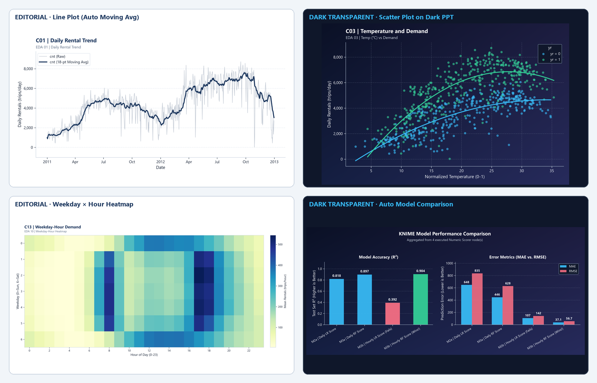
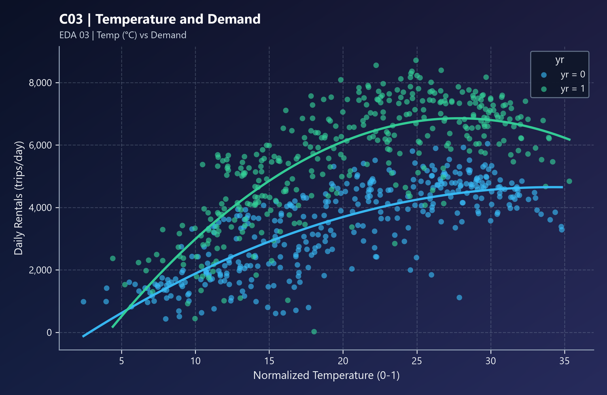
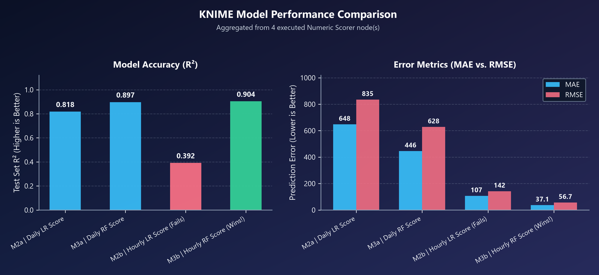
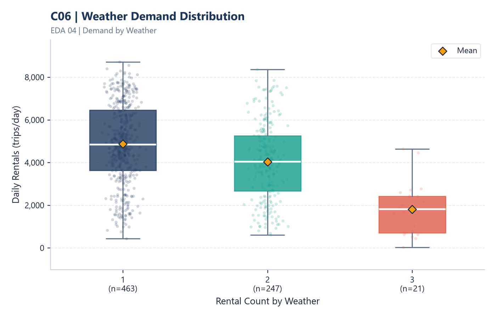
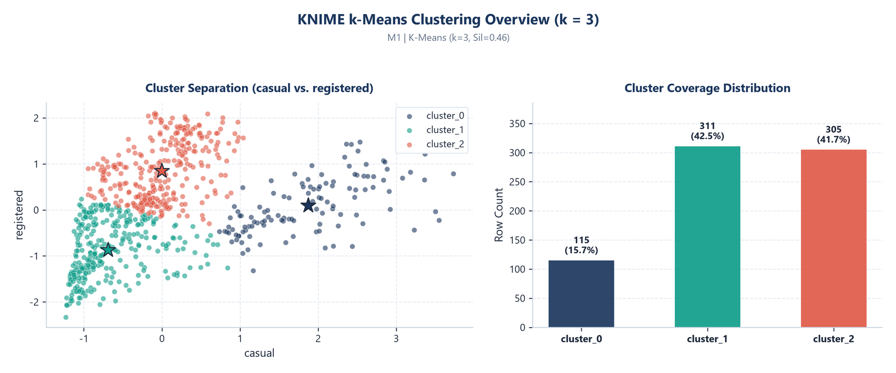
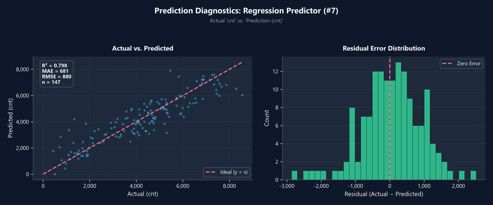
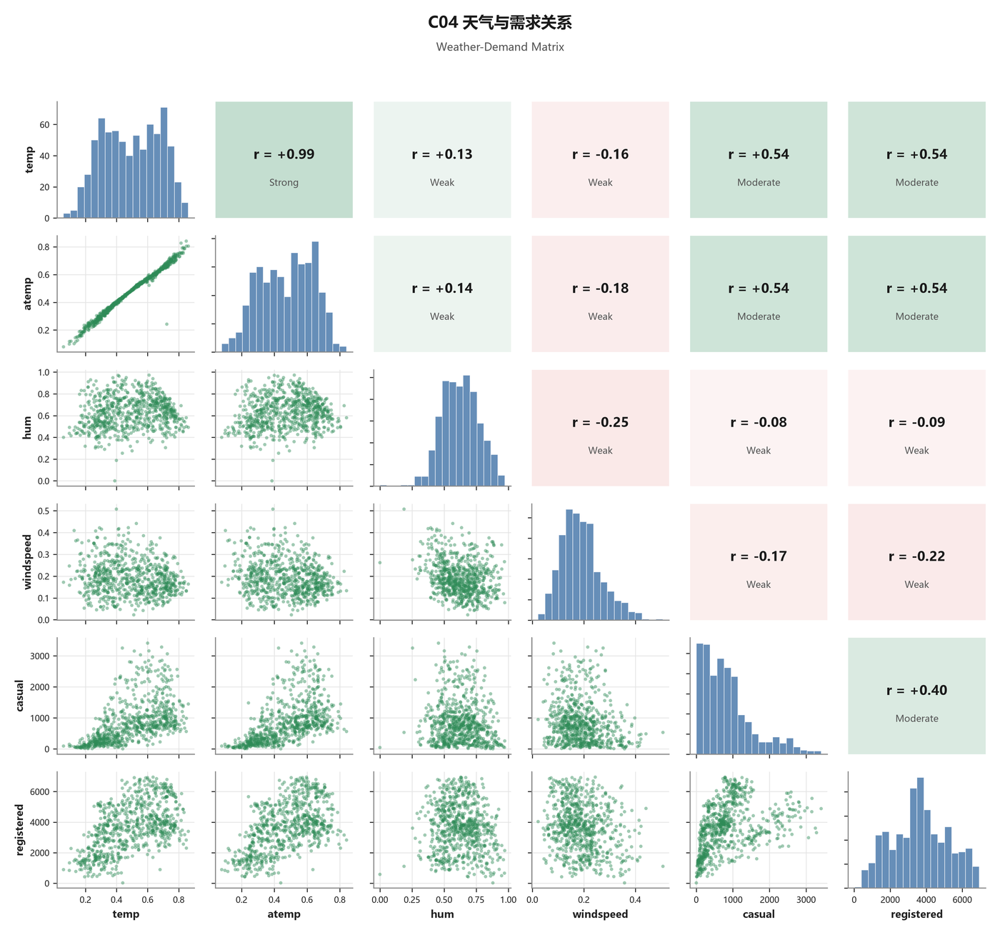
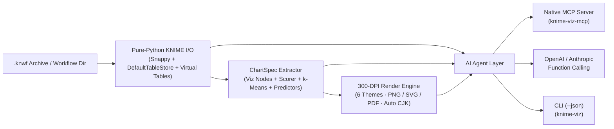

<div align="center">

# KNIME Viz Toolkit

**Automatically turn executed KNIME workflows (`.knwf`) into publication-grade 300-DPI charts — with built-in AI Agent & MCP interfaces.**

[](https://www.python.org/)
[](LICENSE)
[-1B365D?style=flat-square)](#architecture)
[](#ai-agent--mcp-integration)

**English** | [简体中文 (ZH)](README.zh-CN.md)

<br/>



</div>

---

## One-Sentence Install for AI Agents

Copy and send this single prompt to **WorkBuddy, Cursor, Trae, Claude Code, Qwen, Cherry Studio, or Antigravity** — your AI Agent will install the toolkit, wire up MCP/CLI, and render your `.knwf` charts automatically:

```text
Please install knime-viz-toolkit from https://github.com/1222hxy/knime-viz-toolkit.git (pip install "git+https://github.com/1222hxy/knime-viz-toolkit.git[mcp]"), then inspect my executed KNIME workflow (.knwf) using `knime-viz` and render all charts in `dark_transparent` (or `editorial`) 300-DPI theme.
```

> **One-liner for terminal users:**
> ```bash
> pip install "git+https://github.com/1222hxy/knime-viz-toolkit.git"
> ```

---

## Why KNIME Viz Toolkit?

KNIME Analytics Platform is great for building transparent visual data-science pipelines, yet its default chart exports often look dated, low-DPI, or inconsistent across slides and academic papers.

**`knime-viz-toolkit`** bridges the gap:
- **Zero KNIME / Zero Java / Zero `pandas` required** — Pure-Python decoder natively reads KNIME's internal binary tables (`DefaultTableStoreFormat` / `container_12` / `noRowKeyContainer_12`, Xerial Snappy & GZIP, `rearrange_columns_table`, `wrapped_table`, `new_spec_table`, `concatenate_table`, `joined_table`) straight out of `.knwf` archives or unpacked workflow directories.
- **Automatic Node-to-Chart Rendering** — Reads every KNIME visualization node's `settings.xml` (axes, titles, aggregations, limits, annotations, upstream `Color Manager` palettes) and re-renders crisp **300-DPI PNG / SVG / PDF** visuals.
- **Auto-Synthesized Modeling Dashboards** — Automatically detects `Numeric Scorer`, `k-Means`, and `Regression / Random Forest Predictor` nodes to generate multi-model comparison charts, cluster separation regimes, and residual diagnostics.
- **6 Curated Themes (including Transparent Dark PPT)** — Switch seamlessly between `editorial`, `academic`, `nature`, `presentation_dark`, `dark_transparent`, and `knime_enhanced`, with automatic Latin + CJK font resolution (zero tofu glyphs).
- **First-Class AI Agent Support** — Ships with a native **MCP Server** (`knime-viz-mcp`), **OpenAI / Gemini / DeepSeek / Anthropic** function-calling schemas, multimodal `include_base64` inspection, and `--json` CLI output.

---

## Visual Gallery

### 1. Transparent Dark PPT Theme (`dark_transparent`)
True RGBA transparency (`alpha = 0` background) with pure-white typography, translucent gridlines, and frosted legend pills — drop directly onto any dark or gradient PowerPoint / Keynote slide.

<table>
  <tr>
    <td width="50%">
      
      <p align="center"><sub><b>Scatter Plot</b> (auto quadratic trend fit) composited on a dark PPT gradient</sub></p>
    </td>
    <td width="50%">
      
      <p align="center"><sub><b>Auto Model Comparison</b> aggregated from 4 KNIME Numeric Scorer nodes</sub></p>
    </td>
  </tr>
</table>

### 2. Editorial & Academic Publication Themes (`editorial` · `academic`)
Publication-ready typography, jittered mean-marked box plots, k-Means cluster regimes, and full Chinese + English scatter/correlation matrices.

<table>
  <tr>
    <td width="50%">
      
      <p align="center"><sub><code>editorial</code> — <b>Box Plot</b> with jitter strip, group means & sample counts</sub></p>
    </td>
    <td width="50%">
      
      <p align="center"><sub><code>editorial</code> — <b>k-Means Regimes</b> auto-synthesized from KNIME k-Means node</sub></p>
    </td>
  </tr>
  <tr>
    <td width="50%">
      
      <p align="center"><sub><code>presentation_dark</code> — <b>Predictor Diagnostics</b> (Actual vs. Predicted + Residuals)</sub></p>
    </td>
    <td width="50%">
      
      <p align="center"><sub><code>academic</code> — <b>Scatter & Correlation Matrix</b> with automatic CJK font support</sub></p>
    </td>
  </tr>
</table>

---

## Architecture



---

## Installation

```bash
# Quick install directly from GitHub
pip install "git+https://github.com/1222hxy/knime-viz-toolkit.git"

# Or clone locally for development / MCP support
git clone https://github.com/1222hxy/knime-viz-toolkit.git
cd knime-viz-toolkit
pip install -e ".[mcp]"
```

**Core dependencies:** `matplotlib`, `numpy`, `pydantic`, `click` (zero `pandas` or Java required; `table.to_pandas()` is available if `pandas` is installed).

---

## Quick Start

### 1. Command Line (`knime-viz`)

```bash
# Inspect workflow topology, execution states, chart nodes, scorers & k-Means
knime-viz inspect path/to/workflow_EXECUTED.knwf

# Batch-render all chart & analytics nodes in editorial theme (300-DPI PNG)
knime-viz render path/to/workflow_EXECUTED.knwf -o ./out_editorial --theme editorial

# Batch-render transparent-background charts for dark PPT slides
knime-viz render path/to/workflow_EXECUTED.knwf -o ./out_dark_ppt --theme dark_transparent

# Render a single KNIME node (#13) as crisp vector SVG with a custom title
knime-viz render-node path/to/workflow_EXECUTED.knwf 13 -o ./temp_vs_demand.svg --theme academic --format svg --title "Daily Demand vs. Temperature"

# Synthesize a brand-new chart from ANY executed data node (#4) — even without a KNIME chart node
knime-viz custom path/to/workflow_EXECUTED.knwf 4 --kind correlation --value cnt -o ./correlations.png --theme editorial

# Render without the subtle bottom-right GitHub footer watermark
knime-viz render path/to/workflow_EXECUTED.knwf -o ./out_clean --theme academic --no-watermark

# JSON output mode for shell-based AI coding agents
knime-viz inspect path/to/workflow_EXECUTED.knwf --json
```

### 2. Python API

```python
from knime_viz_toolkit import KnimeWorkflow, render_workflow, render_node

# One-liner: render every chart & analytics dashboard in a KNIME workflow
results = render_workflow(
    "Bike_Sharing_Master_Workflow_EXECUTED.knwf",
    output_dir="./out_charts",
    theme="dark_transparent",
    dpi=300,
)
for r in results:
    print(f"[{r.chart_kind}] {r.title} -> {r.output_path}")

# Read any executed KNIME node table directly in pure Python
with KnimeWorkflow("Bike_Sharing_Master_Workflow_EXECUTED.knwf") as wf:
    table = wf.read_node_table(4)
    print(table.shape, table.columns)
    print(table.head(5))
```

See [examples/quickstart_python.py](examples/quickstart_python.py) for a complete runnable script.

---

## AI Agent & MCP Integration

Works out of the box with both desktop AI assistants (**WorkBuddy**, **Cherry Studio**, **Cursor**, **Trae**, **Claude Desktop**, **Antigravity**) and LLM APIs (**Qwen / 通义千问**, **DeepSeek**, **Kimi**, **OpenAI**, **Gemini**, **Anthropic Claude**).

### Option A: Zero-Code MCP Setup (WorkBuddy / Cherry Studio / Cursor / Trae / Claude Desktop / Antigravity)

Add the following to your client's **MCP Servers** configuration (see [examples/mcp_client_config.json](examples/mcp_client_config.json)):

```json
{
  "mcpServers": {
    "knime-viz-toolkit": {
      "command": "knime-viz-mcp",
      "args": []
    }
  }
}
```

Once connected, you can simply chat in plain language — no Python needed:
> *"Inspect my `workflow_EXECUTED.knwf`, re-render all charts in `dark_transparent` theme for my dark PPT slides into `./ppt_charts`, and add a correlation bar chart for node #4."*

*(Tip: Even without configuring MCP, terminal-capable agents such as **WorkBuddy**, **Trae**, **Cursor**, or **Claude Code** can directly run `knime-viz inspect ... --json` and `knime-viz render ...`.)*

### Option B: Qwen (通义千问) / DeepSeek / Kimi / OpenAI / Anthropic Function Calling

Because **Qwen (DashScope / 通义千问)**, **DeepSeek**, **Kimi**, and **Doubao (豆包)** all support the OpenAI-compatible tool-calling format, `toolkit.get_openai_tools()` works directly with all of them:

```python
from openai import OpenAI
from knime_viz_toolkit import KnimeVizAgentToolkit

# Example: Qwen (Alibaba Cloud DashScope) — swap base_url/model for DeepSeek, Kimi, or OpenAI
client = OpenAI(
    api_key="YOUR_DASHSCOPE_API_KEY",
    base_url="https://dashscope.aliyuncs.com/compatible-mode/v1",
)
toolkit = KnimeVizAgentToolkit(cache_workflows=True)

# Export JSON Schemas for Qwen / DeepSeek / OpenAI / Gemini (or get_anthropic_tools() for Claude)
tools = toolkit.get_openai_tools()

resp = client.chat.completions.create(
    model="qwen-plus",
    messages=[{"role": "user", "content": "Render workflow_EXECUTED.knwf in dark_transparent theme."}],
    tools=tools,
)

# Dispatch any tool_call returned by the model
for tc in resp.choices[0].message.tool_calls or []:
    result_json = toolkit.call_tool_json(tc.function.name, tc.function.arguments)
```

See [examples/qwen_deepseek_agent_demo.py](examples/qwen_deepseek_agent_demo.py) (Qwen / DeepSeek) and [examples/agent_tool_calling_demo.py](examples/agent_tool_calling_demo.py) (local tool-calling loop) for runnable scripts.

### Exposed Agent Tools (8)

| Tool | Description |
|---|---|
| `inspect_workflow` | Return workflow topology, node execution status, chart nodes, `Numeric Scorer` metrics & `k-Means` clusters |
| `list_chart_nodes` | Extract normalized `ChartSpec` definitions for all visualization & analytics nodes |
| `read_node_data` | Decode the executed table of any KNIME node (shape, column stats & preview rows) |
| `suggest_charts` | Recommend high-impact charts for any executed KNIME data node |
| `render_node_chart` | Render a single KNIME chart or analytics node with theme/title/label overrides |
| `render_workflow_charts` | Batch-render an entire workflow and emit `manifest.json` |
| `render_custom_chart` | Synthesize any supported chart type from any executed KNIME data node |
| `list_themes` | List available themes, palettes, and transparency defaults |

---

## Supported KNIME Nodes & Themes

### Supported KNIME Nodes

| Category | KNIME Node Types | Output |
|---|---|---|
| **Visualization** | `Bar Chart`, `Line Plot`, `Scatter Plot`, `Box Plot`, `Heatmap`, `Pie Chart`, `Scatter Matrix`, `Histogram` | 300-DPI PNG / SVG / PDF honoring axis labels, aggregations, limits, and `Color Manager` maps |
| **Analytics (Auto)** | `Numeric Scorer`, `k-Means`, `Regression Predictor`, `Random Forest Predictor` | Multi-model R²/MAE/RMSE comparison, k-Means cluster regimes, Actual-vs-Predicted & residual diagnostics |
| **Data Nodes** | `CSV Reader`, `GroupBy`, `Math Formula`, `Row Filter`, `Partitioning`, `Sorter`, `Unpivot`, `Color Manager`, etc. | Direct table decoding, chart recommendations (`suggest_charts`), and custom chart synthesis (`render_custom_chart`) |

### Built-in Themes

| Theme | Background | Best For |
|---|---|---|
| `editorial` | `#FFFFFF` | Consulting decks, executive reports, rich visual hierarchy |
| `academic` | `#FFFFFF` | Minimalist university presentations, theses, clean academic figures |
| `nature` | `#FFFFFF` | Journal papers (colorblind-safe Okabe-Ito palette) |
| `presentation_dark` | `#0F172A` | Standalone dark keynote slides & dashboards |
| `dark_transparent` | **Transparent RGBA** | **Dark / gradient PowerPoint & Keynote slides (no box behind charts)** |
| `knime_enhanced` | `#FFFFFF` | Preserving upstream KNIME `Color Manager` colors with 300-DPI polish |

---

## Running Tests

```bash
python -m unittest discover -s tests -v
```

## License

MIT — see [LICENSE](LICENSE).
