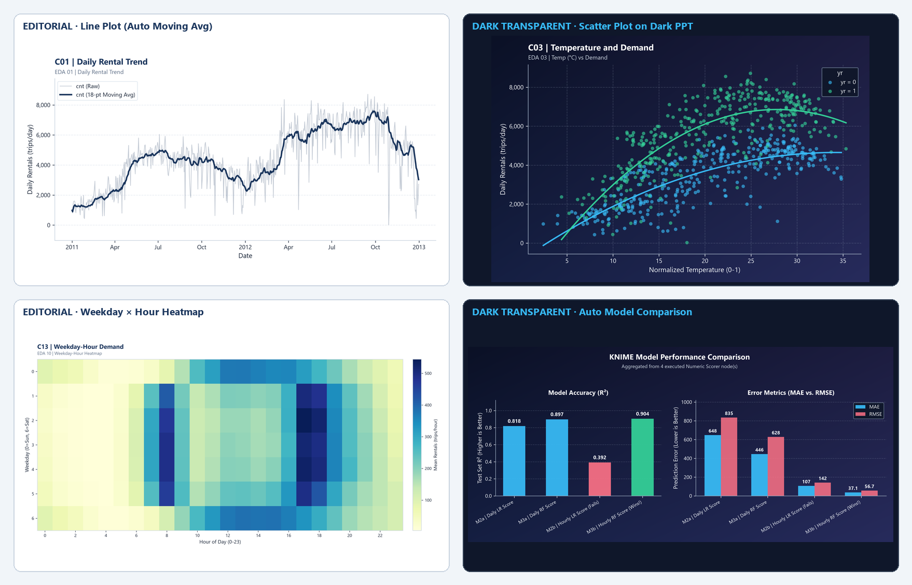
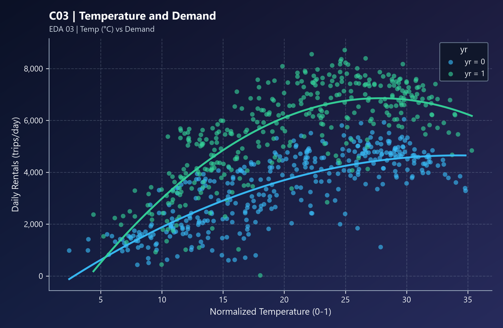
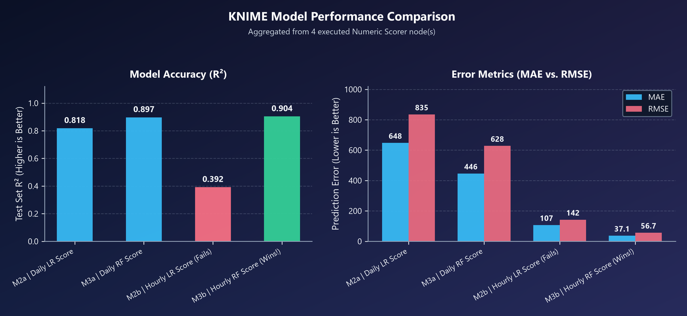
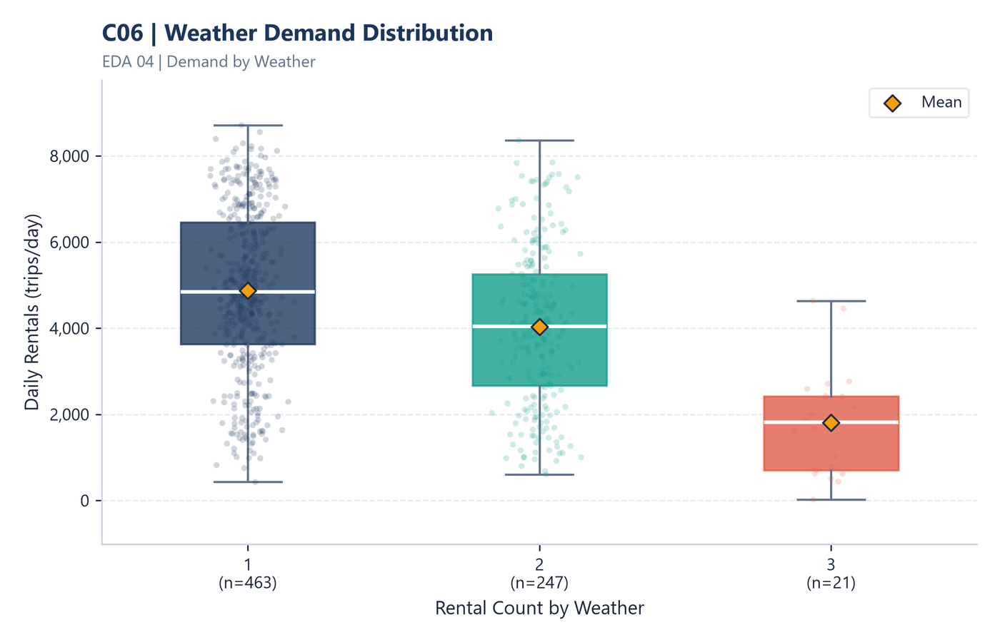
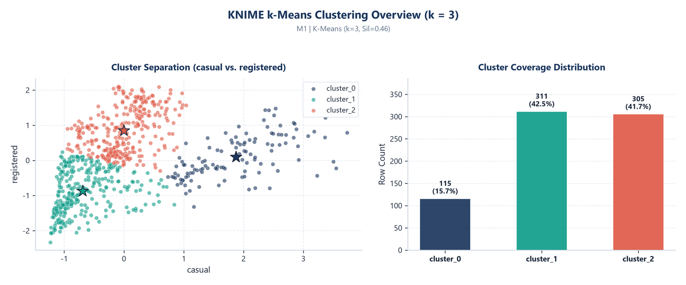
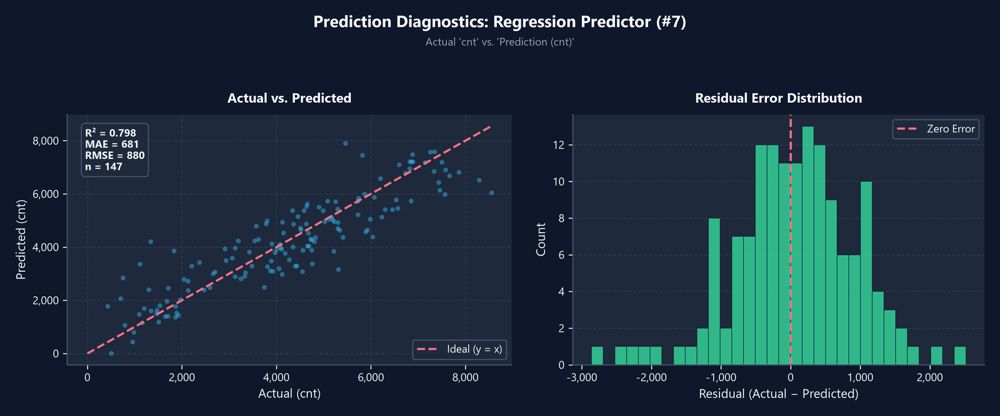
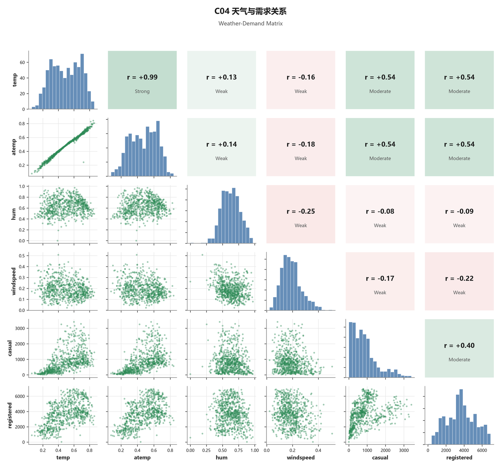
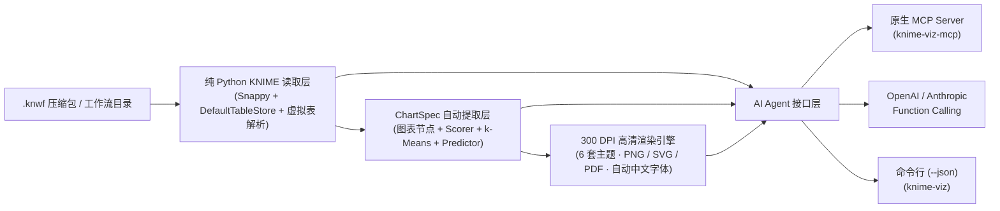

<div align="center">

# KNIME Viz Toolkit

**自动读取已执行的 KNIME 工作流（`.knwf`），一键生成 300 DPI 出版级高清图表 —— 原生内置 AI Agent 与 MCP 接口。**

[](https://www.python.org/)
[](LICENSE)
[-1B365D?style=flat-square)](#架构设计)
[](#ai-agent-与-mcp-集成)

[English](README.md) | **简体中文 (ZH)**

<br/>



</div>

---

## 为什么做这个工具包？

在数据科学课程项目与团队协作中，KNIME 非常适合可视化搭建透明的数据分析流水线，但 KNIME 原生导出的图表往往分辨率偏低、样式陈旧、难以直接放进高质量汇报 PPT 或学术论文。

**`knime-viz-toolkit`** 让你继续享受 KNIME 节点流水线的便利，同时自动获得出版级 Python 图表：
- **零 KNIME / 零 Java / 零 `pandas` 依赖**：纯 Python 原生解码 `.knwf` 压缩包与解压目录中的 KNIME 二进制表格式（`DefaultTableStoreFormat` / `container_12` / `noRowKeyContainer_12`、Xerial Snappy 与 GZIP 压缩、`rearrange_columns_table`、`wrapped_table`、`new_spec_table`、`concatenate_table`、`joined_table`）。
- **自动读取 KNIME 图表节点并高清重绘**：自动解析每个可视化节点的 `settings.xml`（坐标轴、标题、聚合方式、节点批注、上游 `Color Manager` 配色），一键重绘为 **300 DPI PNG / SVG / PDF**。
- **自动合成建模与聚类诊断图**：自动读取 `Numeric Scorer`、`k-Means`、`Regression / Random Forest Predictor`，生成多模型 R²/MAE/RMSE 对比图、聚类分布双联图和预测残差诊断图。
- **6 套出版级主题（含透明底深色 PPT 专用主题）**：支持 `editorial`、`academic`、`nature`、`presentation_dark`、`dark_transparent`、`knime_enhanced`，自动切换中英文字体（彻底告别中文方块乱码）。
- **完备的 AI Agent 接口**：内置原生 **MCP Server**（`knime-viz-mcp`）、**OpenAI / Gemini / DeepSeek / Anthropic** Function Calling Schema、多模态 `include_base64` 自检及 `--json` 命令行模式。

---

## 效果展示

### 1. 透明底深色 PPT 专用主题（`dark_transparent`）
输出真正的透明 RGBA PNG（背景像素 `alpha = 0`），搭配纯白标题、半透明虚线网格与磨砂深色图例框——直接拖进任意深色或渐变 PPT 页面，完全无矩形底框。

<table>
  <tr>
    <td width="50%">
      
      <p align="center"><sub><b>散点图（自动拟合趋势线）</b>叠加在深色渐变 PPT 上的实测效果</sub></p>
    </td>
    <td width="50%">
      
      <p align="center"><sub><b>多模型性能对比</b>（自动汇总 4 个 KNIME Numeric Scorer 节点）</sub></p>
    </td>
  </tr>
</table>

### 2. 出版风 / 极简学术风 / 深色大屏主题（`editorial` · `academic` · `presentation_dark`）
支持带抖动散点与均值菱形的箱线图、k-Means 聚类分布双联图、预测残差诊断图以及中英文零乱码的相关性散点矩阵。

<table>
  <tr>
    <td width="50%">
      
      <p align="center"><sub><code>editorial</code> — <b>箱线图</b>（叠加散点抖动、分组均值与样本量标注）</sub></p>
    </td>
    <td width="50%">
      
      <p align="center"><sub><code>editorial</code> — <b>k-Means 聚类总览</b>（直接从 KNIME k-Means 节点自动合成）</sub></p>
    </td>
  </tr>
  <tr>
    <td width="50%">
      
      <p align="center"><sub><code>presentation_dark</code> — <b>预测诊断图</b>（实际值 vs 预测值 + 残差分布）</sub></p>
    </td>
    <td width="50%">
      
      <p align="center"><sub><code>academic</code> — <b>散点与相关性矩阵</b>（自动中英文字体支持，无乱码）</sub></p>
    </td>
  </tr>
</table>

---

## 架构设计



---

## 快速安装

```bash
git clone <你的仓库地址>
cd knime-viz-toolkit
pip install -e .

# 可选：启用 MCP Server 支持（如环境未安装 mcp）
pip install -e ".[mcp]"
```

**核心依赖：** 仅需 `matplotlib`、`numpy`、`pydantic`、`click`（无需 `pandas` 或 Java；若环境已装 `pandas`，可随时调用 `table.to_pandas()` 转换）。

---

## 快速上手

### 1. 命令行（`knime-viz`）

```bash
# 查看工作流拓扑、执行状态、图表节点、Numeric Scorer 与 k-Means 摘要
knime-viz inspect path/to/workflow_EXECUTED.knwf

# 一键批量导出全套出版风 300 DPI 高清图
knime-viz render path/to/workflow_EXECUTED.knwf -o ./out_editorial --theme editorial

# 一键批量导出透明底深色 PPT 专用高清图
knime-viz render path/to/workflow_EXECUTED.knwf -o ./out_dark_ppt --theme dark_transparent

# 单独渲染某个 KNIME 节点（如 #13）为矢量 SVG 并自定义标题
knime-viz render-node path/to/workflow_EXECUTED.knwf 13 -o ./temp_vs_demand.svg --theme academic --format svg --title "Daily Demand vs. Temperature"

# 从任意数据节点（#4）自由生图（即使 KNIME 中未连接图表节点！）
knime-viz custom path/to/workflow_EXECUTED.knwf 4 --kind correlation --value cnt -o ./correlations.png --theme editorial

# 供命令行 AI Agent 使用的结构化 JSON 输出模式
knime-viz inspect path/to/workflow_EXECUTED.knwf --json
```

### 2. Python API

```python
from knime_viz_toolkit import KnimeWorkflow, render_workflow, render_node

# 一行代码批量出图（透明底深色 PPT 主题）
results = render_workflow(
    "Bike_Sharing_Master_Workflow_EXECUTED.knwf",
    output_dir="./out_charts",
    theme="dark_transparent",
    dpi=300,
)
for r in results:
    print(f"[{r.chart_kind}] {r.title} -> {r.output_path}")

# 纯 Python 直接读取任意 KNIME 节点的输出数据表
with KnimeWorkflow("Bike_Sharing_Master_Workflow_EXECUTED.knwf") as wf:
    table = wf.read_node_table(4)
    print(table.shape, table.columns)
    print(table.head(5))
```

完整脚本示例见 [examples/quickstart_python.py](examples/quickstart_python.py)。

---

## AI Agent 与 MCP 集成

### 方式 A：原生 MCP Server（Claude Desktop / Cursor / Antigravity）

参考 [examples/mcp_client_config.json](examples/mcp_client_config.json)，将以下配置添加到你的 MCP 客户端：

```json
{
  "mcpServers": {
    "knime-viz-toolkit": {
      "command": "knime-viz-mcp",
      "args": []
    }
  }
}
```

### 方式 B：OpenAI / Gemini / DeepSeek / Anthropic Function Calling

```python
from knime_viz_toolkit import KnimeVizAgentToolkit

toolkit = KnimeVizAgentToolkit(cache_workflows=True)

# 导出标准工具声明 Schema
openai_tools = toolkit.get_openai_tools()
anthropic_tools = toolkit.get_anthropic_tools()

# 模型返回 tool_call 后直接调度执行
result = toolkit.call_tool(
    "render_node_chart",
    {
        "workflow_path": "Bike_Sharing_Master_Workflow_EXECUTED.knwf",
        "node_id": 13,
        "output_path": "out/scatter_dark.png",
        "theme": "dark_transparent",
        "include_base64": True,  # 可选：返回 base64 PNG 供多模态模型视觉自检
    },
)
```

完整 Agent 调用演示见 [examples/agent_tool_calling_demo.py](examples/agent_tool_calling_demo.py)。

### 内置 8 个 Agent 工具

| 工具名 | 功能说明 |
|---|---|
| `inspect_workflow` | 返回工作流拓扑、节点执行状态、图表节点、`Numeric Scorer` 指标与 `k-Means` 聚类摘要 |
| `list_chart_nodes` | 提取所有可视化节点与自动分析图的标准化 `ChartSpec` |
| `read_node_data` | 解码任意已执行 KNIME 节点的数据表（行列数、列统计与预览数据） |
| `suggest_charts` | 根据数据节点字段类型与分布自动推荐最值得画的高价值图表 |
| `render_node_chart` | 渲染指定 KNIME 图表或分析节点，支持覆盖主题、标题与坐标轴标签 |
| `render_workflow_charts` | 批量渲染整份工作流并输出 `manifest.json` 索引清单 |
| `render_custom_chart` | 从任意已执行 KNIME 数据节点自由合成指定类型的高清图表 |
| `list_themes` | 查询全部可用主题、调色板及透明背景配置 |

---

## 支持的 KNIME 节点与主题

### 支持的 KNIME 节点

| 类别 | 支持的 KNIME 节点 | 输出结果 |
|---|---|---|
| **可视化节点** | `Bar Chart`、`Line Plot`、`Scatter Plot`、`Box Plot`、`Heatmap`、`Pie Chart`、`Scatter Matrix`、`Histogram` | 自动继承轴标签、聚合方式、范围限制及 `Color Manager` 配色，输出 300 DPI PNG / SVG / PDF |
| **建模分析节点（自动合成）** | `Numeric Scorer`、`k-Means`、`Regression Predictor`、`Random Forest Predictor` | 多模型 R²/MAE/RMSE 对比图、k-Means 聚类分布双联图、实际值 vs 预测值与残差诊断图 |
| **通用数据节点** | `CSV Reader`、`GroupBy`、`Math Formula`、`Row Filter`、`Partitioning`、`Sorter`、`Unpivot`、`Color Manager` 等 | 直接读取数据表、自动图表推荐（`suggest_charts`）、自由定制出图（`render_custom_chart`） |

### 内置 6 套主题

| 主题名 | 背景 | 适用场景 |
|---|---|---|
| `editorial` | `#FFFFFF` | 咨询/商业分析汇报、高层次视觉呈现 |
| `academic` | `#FFFFFF` | 课程汇报、学位论文、极简无杂物学术风 |
| `nature` | `#FFFFFF` | 科研论文投稿（Okabe-Ito 色盲友好调色板） |
| `presentation_dark` | `#0F172A` | 独立深色大屏与深色主题看板 |
| `dark_transparent` | **透明 RGBA** | **深色 / 渐变 PPT 与 Keynote 专用（无矩形底框，完美融入页面）** |
| `knime_enhanced` | `#FFFFFF` | 保留 KNIME 上游 `Color Manager` 配色并升级为 300 DPI 现代排版 |

---

## 运行测试

```bash
python -m unittest discover -s tests -v
```

## 开源协议

MIT — 详见 [LICENSE](LICENSE)。
